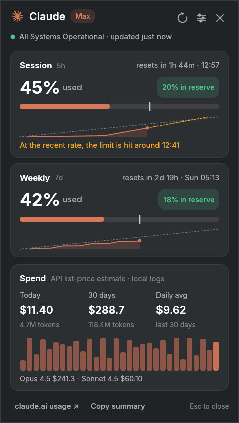

# Limitray

Your Claude (and Codex, Gemini, …) usage limits, pace and local spend in the Linux tray.

<p align="center"></p>

Limitray is an unofficial tray app built on the [CodexBar](https://github.com/steipete/CodexBar)
CLI, which does the provider fetching. It is separate from CodexBar's own Qt desktop app.
Formerly called `codexbar-tray`.

It is a single Rust binary (egui + StatusNotifierItem). It works on KDE Plasma, GNOME (with the
AppIndicator extension), Sway/Hyprland (waybar tray) and X11. The CodexBar CLI does the provider
fetching; the installer downloads it for you.

## Install

```sh
curl -fsSL https://raw.githubusercontent.com/gabors0/limitray/main/install.sh | sh
```

You can also download `limitray-x86_64` (or `-aarch64`) from
[Releases](https://github.com/gabors0/limitray/releases), then run:

```sh
chmod +x limitray-x86_64 && ./limitray-x86_64 install
```

`install` does the following, all inside your home directory:

- copies the app to `~/.local/bin/limitray`
- downloads the latest static CodexBar CLI into `~/.local/lib/codexbar-cli`, verifies its
  checksum and links it to `~/.local/bin/codexbar`. A CLI you already have is reused.
- adds a launcher entry, an icon and login autostart, then starts the tray

Options: `--no-autostart`, `--no-start`, `--update-cli`.

**Claude login:** sign in once with Claude Code (`claude`). The CodexBar CLI reads the same credentials,
so there is nothing to paste.

Without the CLI, the app still downloads it on first start, so the bare binary on its own works too.

**Upgrading from codexbar-tray:** run the install command above. It stops the old app, carries
your settings over and removes the old binary, launcher and autostart entries. Your CodexBar CLI
is kept.

## Use

| Action | Tray icon |
|---|---|
| Left click | open/close the window |
| Middle click | refresh now |
| Right click | live numbers, icon style, providers, notifications |

Window keys: `Ctrl+R` refresh, `Ctrl+,` settings, `Esc` close.

Commands: `limitray --status` (JSON), `--refresh`, `--toggle` (bind it to a hotkey),
`--quit`, `waybar`, `update`, `update-cli`, `uninstall [--purge]`.

Each window card shows its usage so far against an even pace. When the recent rate would use up
the limit before the reset, the card says around when.

### Waybar

`limitray waybar` keeps printing one JSON line per change for a
[custom module](https://github.com/Alexays/Waybar/wiki/Module:-Custom), using the provider and
window the tray icon tracks. It starts the background service if it isn't running yet.

```jsonc
"custom/limitray": {
  "exec": "limitray waybar",
  "return-type": "json",
  "format": "AI {}",
  "on-click": "limitray --toggle",
  "on-click-middle": "limitray --refresh"
}
```

```css
#custom-limitray.warning { color: #e5a50a; }
#custom-limitray.critical { color: #e01b24; }
#custom-limitray.stale, #custom-limitray.offline { opacity: 0.5; }
```

The line also carries `percentage` (for `format-icons`) and `alt` (the provider id). Classes are
`normal`, `warning` and `critical` (your notification thresholds), plus `stale`, `error`,
`loading` and `offline`.

## Updates

Once a day the tray checks GitHub for new releases of itself and of the CodexBar CLI it installed.
When one is out, the right-click menu and the popup offer to install it; nothing updates on its
own. `limitray update` updates both from a terminal (`--check` only reports), and
`update-cli` reinstalls just the CLI. Downloads are verified against their published SHA-256.
The previous app version is kept as `~/.local/bin/limitray.bak`, and the tray restarts on
the new one.

Only the app copy in `~/.local/bin` updates itself, and only a CLI the app installed is offered
updates; a CLI you installed yourself is left alone. Turn the daily check off under
Settings → Advanced (`"check_updates": false`).

## Files

- Settings: `~/.config/limitray/config.json`
- Cache (instant first paint): `~/.cache/limitray/snapshot.json`
- Usage history (last 8 days): `~/.cache/limitray/history.jsonl`

## Build from source

```sh
cargo build --release && ./install.sh
```

Building needs a C linker (`gcc`). `./cargo.sh build --release` builds in a small Podman container
when you don't have one. Pushing a `v*` tag makes GitHub Actions publish the release
binaries (`.github/workflows/release.yml`). Without a terminal, run the Release workflow from the
Actions tab with the version (e.g. `v0.3.0`); it creates the tag together with the release.

## Credits

Built on [CodexBar](https://github.com/steipete/CodexBar) by Peter Steinberger (MIT). Provider
icons come from that project. See `LICENSE`.
